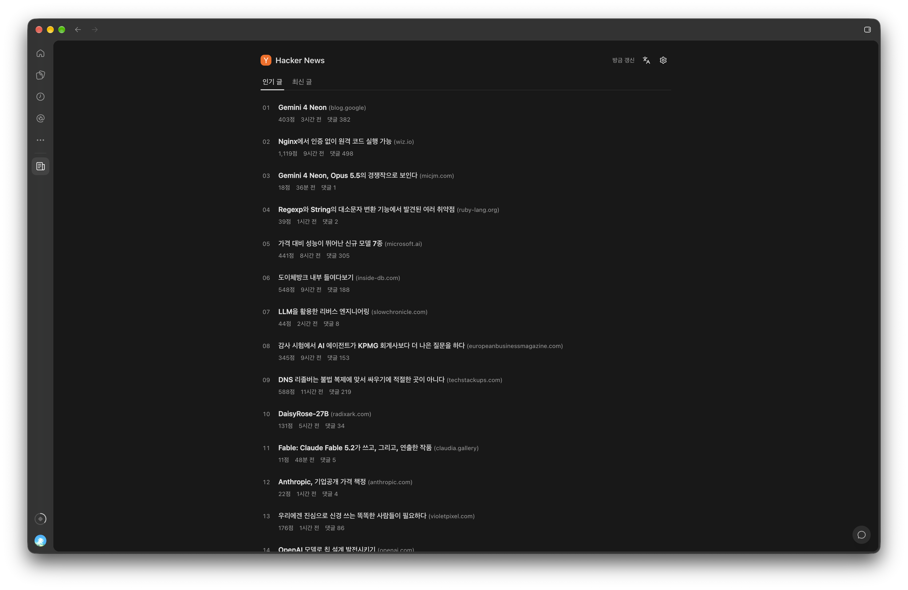
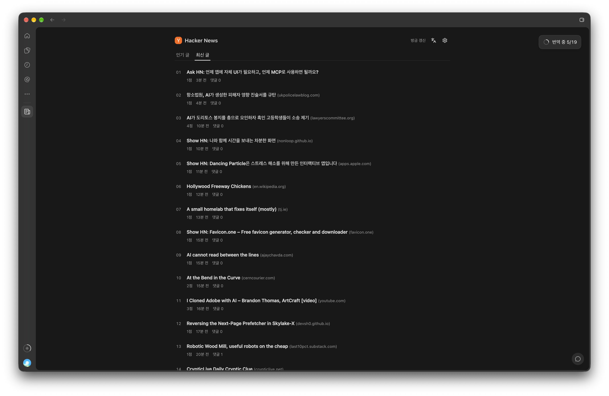
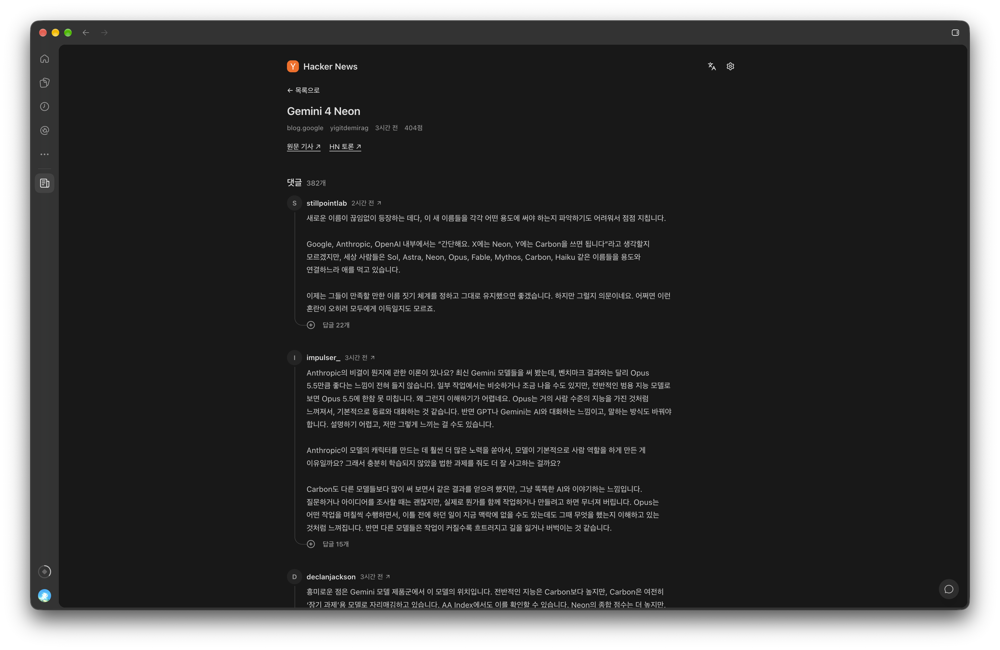
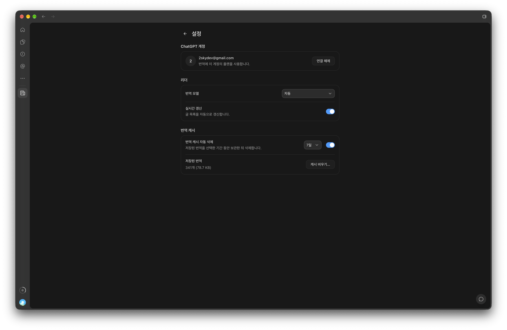

# Hacker News Korean - Codex Plugin

Codex 사이드바나 브라우저에서 Hacker News의 인기 글과 최신 글을 읽는 로컬 리더입니다. ChatGPT 계정을 연결하면 글 제목과 댓글을 한국어로 번역할 수 있습니다.



<details>
<summary>최신 글, 댓글, 설정 화면 더 보기</summary>







</details>

## Codex에 설치

설치할 Mac에서 비공개 저장소를 읽을 수 있도록 GitHub 인증이 되어 있어야 합니다.

1. Codex의 **플러그인 → 추가 → 마켓플레이스 추가**를 엽니다.
2. **출처**에 `https://github.com/2skydev/hacker-news-codex-plugin.git`을 입력합니다. **Git ref**는 `main`으로 지정하고 **Sparse 경로**는 비워 둡니다.
3. 마켓플레이스를 추가한 뒤 **Hacker News**를 설치합니다.
4. 사이드바의 **… → Hacker News**에서 리더를 엽니다. [피드 직접 열기](codex://plugins/hacker-news@hacker-news-codex-plugin/app/open_reader)

업데이트하려면 **플러그인 → 관리 → 마켓플레이스**에서 **Hacker News**의 **업그레이드**를 누른 뒤 리더를 다시 엽니다.

## 브라우저에서 실행

Mac에서 Node.js 24 이상으로 아래 명령을 실행하고, 터미널에 표시되는 로컬 주소를 브라우저에서 엽니다.

```sh
npm ci
npm run build:standalone
npm start
```

## 한국어 번역

- **설정 → ChatGPT로 로그인**에서 계정을 연결하고 플랜 사용을 허용합니다.
- **댓글**을 눌러 토론을 열고, 답글을 펼쳐 번역합니다. **영문 함께 보기**로 원문을 확인할 수 있습니다.
- **설정**에서 번역 모델과 피드 자동 갱신을 바꾸거나 번역 캐시를 비울 수 있습니다. 번역 캐시는 기본 7일간 보관합니다.

## 로컬 데이터

리더는 Hacker News 공식 API에서 글과 댓글을 가져오고, 번역할 텍스트를 OpenAI에 보냅니다. 설정과 번역 캐시는 기본적으로 `~/.local/share/hacker-news/`에 저장합니다. `HN_DATA_DIR`로 저장 경로를 바꿀 수 있습니다.

ChatGPT 계정 연결 정보는 macOS 키체인에 저장합니다. 같은 데이터 경로를 사용하는 Codex와 브라우저가 연결을 공유합니다. 이전 버전에서 연결한 계정은 업데이트 후 다시 로그인해야 합니다.

## 개발

`npm ci`로 의존성을 설치한 뒤 `npm run dev`로 개발 서버를 실행합니다. 정적 검사와 테스트는 각각 `npm run check`와 `npm test`로 실행합니다.

플러그인을 배포할 때는 `npm run build`로 생성한 `dist/hacker-news/`를 소스와 함께 커밋해 `main`에 푸시합니다.
